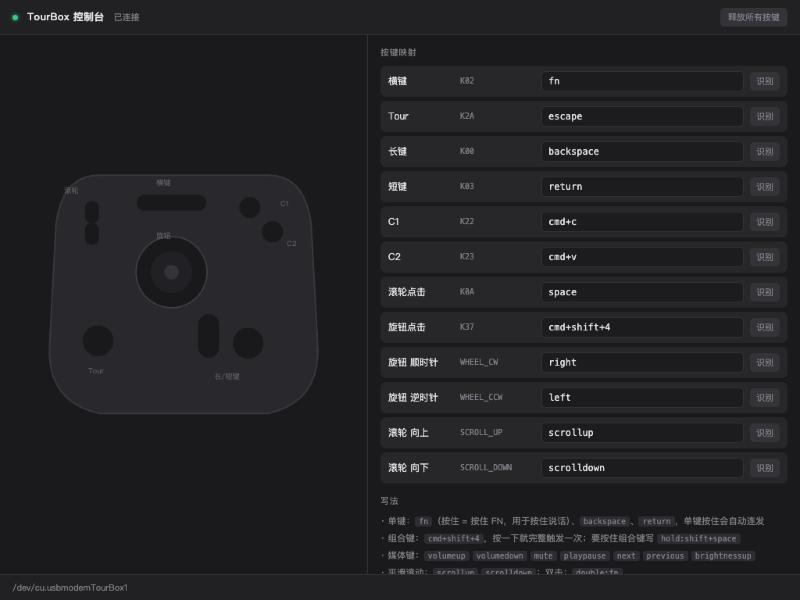

# TourBox Lite · macOS 全局按键映射驱动

把 TourBox Lite 当成**全局快捷键盘**用：每个按钮、旋钮、滚轮都可以映射成任意按键、组合键、媒体键或平滑滚动，在**所有应用**里生效。官方 TourBox Console 只对剪映、达芬奇、Photoshop 这类指定软件生效，这个驱动没有这个限制。

最初做它是为了一件事：**按住 TourBox 上的一个键说话，松手结束**，代替按住键盘左下角 Fn 键的语音输入。

> 非官方项目，与 TourBox Tech Inc. 无关。协议是对设备串口数据做黑盒实测得到的，没有使用官方代码。



## 功能

- **全局映射**：单键、组合键（`cmd+shift+4`）、修饰键按住（`fn`）、媒体键、双击
- **按住说话**：把一个键映射为 `fn`，按住 = 按住 Fn，松手 = 松开
- **按住连发**：映射成单键（如 `backspace`）后，按住会像真键盘一样连续触发
- **触控板式平滑滚动**：滚轮按「格」计算距离，按像素逐帧输出，带手势相位和惯性
- **本地可视化控制台** `http://127.0.0.1:8777/`：设备俯视图、实时按键高亮、点一下就能改映射、「识别」向导
- **按键统计**：每天按了哪些快捷键、功能键，键盘和 TourBox 分开计数，控制台里看排行和 24 小时分布，并标出「常用但 TourBox 上还没有」的组合，方便决定该映射什么（见下文「按键统计」）
- **防卡键**：串口断开、进程退出、长时间收不到松开信号时会自动松开所有按键；控制台里也有「释放所有按键」按钮
- **常驻运行**：作为 launchd 登录项运行，崩溃后自动拉起；设备拔掉再插上会自动重连

## 适配性

### 硬件 / 系统

| 项目 | 状态 |
|---|---|
| TourBox **Lite**（USB，VID `0xCAFE` / PID `0x4001`） | ✅ 已实测 |
| TourBox Neo / Elite / 蓝牙连接 | ❓ 未测试。Neo 的协议和 Lite 同源，但按下/松开位相反，键位也更多，需要先用 `calibrate.py` 重新校准 |
| macOS 27 · Apple Silicon (M1) | ✅ 已实测 |
| 更早的 macOS / Intel Mac | 理论可用，未测试 |

### 语音输入法（按住说话）

| 输入法 | 状态 | 说明 |
|---|---|---|
| **豆包输入法** | ✅ 可用 | 设置成「按住 Fn 说话」，再把 TourBox 的一个键映射为 `fn` 即可 |
| **微信输入法（WeType）** | ❌ 暂不支持 | 原因见下文 |
| macOS 自带听写 | ❓ 未测试 | 走系统快捷键，理论上可以触发 |

#### 为什么微信输入法暂时不行

macOS 上的按键事件分两层：

```
 物理键盘 ──► [HID 硬件层] ──► [CGEvent 事件层] ──► 应用 / 输入法
                  ▲                  ▲
          IOHIDManager 在这里听   CGEventTap 在这里听
                                     ▲
                       本驱动的按键从这里注入（CGEventPost）
```

- 这个驱动和所有不装内核/系统扩展的软件改键工具一样，用 `CGEventPost` 把按键**注入到事件层**。
- **豆包输入法**通过 `CGEventTap` 监听事件层，它的程序里有 `ASRShortcutEventTapMonitor` 这类符号，所以能收到注入的 Fn。
- **微信输入法**的程序直接链接了 `IOHIDManagerCreate` / `IOHIDManagerSetDeviceMatching`，也就是从 **HID 硬件层** 读取 Fn 键状态。注入到事件层的按键根本不会经过那一层，所以它看不到。开发过程中试过 Fn、Fn+Space、Shift+Space 等多种组合，物理键盘都能触发，TourBox 注入的都不行，和这个判断一致。
- 要让它在硬件层「看见」按键，就得**冒充一块真实的 USB 键盘（虚拟 HID 设备）**。新版 macOS 要求这类程序带苹果签发的 DriverKit 授权，`sudo` 也不行（`experiments/hidtest.swift` 里的 `IOHIDUserDeviceCreate` 实测返回 nil）。

可能的解决办法（目前都还没实现）：

1. 接入 [Karabiner-DriverKit-VirtualHIDDevice](https://github.com/pqrs-org/Karabiner-DriverKit-VirtualHIDDevice)：它已经有签名过的虚拟键盘，可以借它发出「硬件层」的 Fn
2. 硬件桥：用 ESP32 / RP2040 一类板子读 TourBox，再以 USB 键盘身份接到 Mac
3. 微信输入法哪天改用事件层监听，就自然能用了

### 应用快捷键

普通按键、组合键（复制粘贴、截图、撤销等）、方向键在所有应用里都能用。平滑滚动在浏览器、访达、大多数原生应用里表现接近触控板。少数自己处理滚轮的应用（比如部分游戏、远程桌面）可能会忽略像素级滚动。

## 安装

前提：**先退出 TourBox Console**，它会独占串口，不退出会报 `Resource busy`。

```bash
git clone https://github.com/halfrightlab/tourbox-lite-macos.git
cd tourbox-lite-macos
./install.sh
```

`install.sh` 会：

- 在 `~/.tourbox/venv` 建好 Python 环境
- 生成 `~/Library/LaunchAgents/com.tourbox.driver.plist` 并注册为登录自启
- 打印需要授权的 Python 路径

**授权一次辅助功能权限**：系统设置 → 隐私与安全性 → 辅助功能 → 点 + 添加安装脚本打印出来的 python3 路径并勾选。没有这个权限，按键注入会被系统静默丢弃。

> 辅助功能权限认的是「具体那个程序文件」。以后升级了 Python 导致路径变化，就需要重新勾选一次。

只想临时跑一下、不装服务：

```bash
pip3 install -r requirements.txt
python3 webui.py          # 带控制台，自动打开浏览器
python3 tourboxd.py       # 无界面
```

卸载服务：`./uninstall.sh`

## 映射写法

在控制台的输入框里填写，回车立即生效。也可以直接编辑 `config.json`（首次运行时自动生成）。

| 写法 | 效果 |
|---|---|
| `fn` / `shift` / `cmd` … | 按住 TourBox = 按住该修饰键（「按住说话」就用 `fn`） |
| `backspace` `return` `space` `escape` `a` `f5` `left` … | 单键，按住会自动连发 |
| `cmd+return` `cmd+shift+4` `cmd+c` | 组合键，按一下就完整触发一次 |
| `hold:shift+space` | 组合键，按住期间保持按下 |
| `volumeup` `volumedown` `mute` `playpause` `next` `previous` `brightnessup` `brightnessdown` | 媒体键 |
| `scrollup` / `scrolldown` | 平滑滚动（滚轮专用） |
| `scroll:200` | 按指定像素滚动 |
| `double:fn` | 连按两下 |

修饰键可用 `cmd` `shift` `alt`(`option`) `ctrl` `fn`。

> 旋钮和滚轮转动时设备只发脉冲、不发「松开」，所以别把它们映射成 `fn` 这类按住式按键。

### 默认键位

| 位置 | 字节 | 默认映射 |
|---|---|---|
| 横键 | `K02` | `fn`（按住说话） |
| 长键 | `K00` | `backspace` |
| 短键 | `K03` | `return` |
| C1 / C2 | `K22` / `K23` | `cmd+c` / `cmd+v` |
| Tour | `K2A` | `escape` |
| 滚轮点击 | `K0A` | `space` |
| 旋钮点击 | `K37` | `cmd+return`（输入框里换行：微信、飞书、ChatGPT 等「回车发送」的输入框） |
| 旋钮 顺/逆 | `WHEEL_CW` / `WHEEL_CCW` | `right` / `left` |
| 滚轮 上/下 | `SCROLL_UP` / `SCROLL_DOWN` | `scrollup` / `scrolldown` |

### 其他可调参数（`config.json`）

| 键 | 默认 | 说明 |
|---|---|---|
| `divider.WHEEL_CW` 等 | 4 | 旋钮每 N 个脉冲触发一次（转一格大约 6–10 个脉冲） |
| `scroll.click_px` | 130 | 滚轮一格滚多少像素 |
| `scroll.decay` | 0.12 | 每帧走掉剩余距离的比例：越大起步越快、尾巴越短 |
| `scroll.boost_max` | 1.8 | 快速连转时的加速倍率上限 |
| `stuck_release_sec` | 60 | 按住超过多少秒没收到松开就强制释放（防丢包卡键） |
| `repeat_delay` / `repeat_interval` | 0.42 / 0.032 | 按住连发的延迟和间隔（秒） |
| `stats` | true | 按键统计开关 |

## 按键统计

驱动在后台用一个**只读**的事件监听（不拦截、不修改任何按键）统计你每天按了什么，控制台底部「使用统计」可以按今天 / 7 天 / 30 天查看。

- **只记次数，不记内容**：`cmd+c`、`backspace`、`return` 这类快捷键和功能键按标签计数；普通打字（字母、数字、符号，含 Shift）只累加成一个「打字」总数，不记录具体是哪个字母，也不记顺序，所以从统计文件里还原不出你打过的字
- 密码框会开启系统的「安全输入」，那期间系统本来就不让任何程序看到按键
- TourBox 触发的按键会打上标记，排行里蓝色部分是 TourBox、灰色是键盘；滚轮按格计数，媒体键也会计入
- 「TourBox 按键」一栏按**实体键**计数：每个键用了几次、现在映射成什么（旋钮按触发次数、滚轮按格计），两个键映射成同一个按键也能分开看
- 数据在 `~/.tourbox/stats/日期.json`，只存在本机。不想统计就在 `config.json` 里写 `"stats": false` 然后重启驱动
- 资源占用：每次按键多一次计数，每分钟最多写一次小文件，实测对 CPU 和内存没有可见影响
- 权限：需要「输入监控」。已经给了辅助功能权限的话通常已经够用；日志里看到 `输入监控(统计)=未授权` 且统计一直是 0，就去 系统设置 → 隐私与安全性 → 输入监控 里勾选同一个 python3

## 协议（TourBox Lite 实测）

USB CDC 串口 `/dev/cu.usbmodemTourBox*`，115200 8N1，单字节事件流：

- **按钮**：按下发 `code`，松开发 `code | 0x80`
- **旋钮 / 滚轮**：每转一格连发若干个相同字节，没有松开字节

| 控件 | 按下码 |
|---|---|
| 按钮 | `00` `02` `03` `22` `23` `2a` `37` |
| 滚轮点击 | `0a` |
| 滚轮 上 / 下 | `49` / `09` |
| 旋钮 顺 / 逆 | `44` / `04` |

规律：Lite 的按下码 = Neo 的按下码 `& 0x7F`。Neo 的协议参考了 [raleighlittles/tourbox_neo_linux_driver](https://github.com/raleighlittles/tourbox_neo_linux_driver)。

## 文件

| 文件 | 作用 |
|---|---|
| `tourboxd.py` | 驱动核心：协议解析、按键注入、平滑滚动、防卡键；也可以无界面运行，`--sniff` 只打印原始字节 |
| `webui.py` | 驱动 + 本地控制台服务（常驻服务跑的就是它） |
| `keystats.py` | 按键统计（只读监听，只记次数） |
| `console.html` | 控制台页面，自动跟随系统浅色/深色 |
| `calibrate.py` | 协议校准器，适配新型号时用 |
| `install.sh` / `uninstall.sh` | 安装 / 卸载登录自启服务 |
| `tests/` | 离线单元测试（用假注入器，不会真的发出按键）：`python3 -m unittest discover tests` |
| `experiments/hidtest.swift` | 虚拟 HID 键盘实验（失败记录，留作参考） |

## 故障排查

- **按了没反应**：看 `~/.tourbox/logs/driver.log`，确认有 `辅助功能(注入)=已授权` 和 `已连接`
- **Resource busy**：执行 `pkill -f "TourBox Console"`
- **某个键卡住了（系统输入错乱）**：点控制台右上角「释放所有按键」，或者直接拔掉 TourBox，驱动会自动松开所有键
- **重启驱动**：`launchctl kickstart -k gui/$(id -u)/com.tourbox.driver`

## License

MIT
