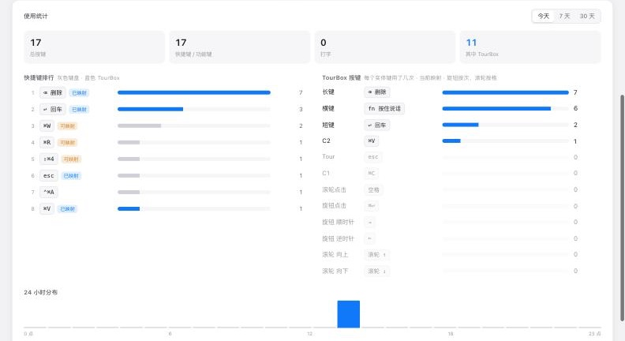

# TourBox Lite · macOS 全局按键映射驱动

> 一块原本只会在剪映和 Photoshop 里上班的 TourBox，现在全 Mac 打工。

TourBox Lite 是个好东西，可惜官方驱动只在剪映、达芬奇、Photoshop 这些「指定单位」里干活，一出门就失业。这个驱动给它办了张全 Mac 通行证：**每个按钮、旋钮、滚轮都能映射成任意按键、组合键、媒体键或平滑滚动，在所有应用里生效。**

它最初只为一件小事而生：**按住 TourBox 说话，松手结束**。再也不用把手指伸到键盘左下角，摸索着按住那个小小的 Fn 键。后来顺手做了平滑滚动、按住连发、可视化控制台，还给它装了个「记账本」：帮你统计每天到底按了哪些键，最值得把什么放到 TourBox 上。

[](LICENSE)
[](#适配性谁能用谁暂时不行)
[](requirements.txt)

> 非官方项目，与 TourBox Tech Inc. 无关。协议是对设备串口数据做黑盒实测得到的，没有用到任何官方代码。


## 它能干什么

- **全局映射**：单键、组合键（`cmd+shift+4`）、修饰键按住（`fn`）、媒体键、双击
- **按住说话**：把一个键映射为 `fn`，按住 = 按住 Fn，松手 = 松开
- **按住连发**：映射成单键（如 `backspace`）后，按住会像真键盘一样连续触发
- **触控板式平滑滚动**：滚轮按「格」计算距离，按像素逐帧输出，带手势相位和惯性
- **本地可视化控制台** `http://127.0.0.1:8777/`（设置模式下）：设备俯视图、实时按键高亮、点一下就能改映射、「识别」向导
- **按键统计**：用自己的真实数据看出哪些按键用得最多、最应该映射到 TourBox 上。键盘和 TourBox 分开计数，标出「常用但还没映射」的操作和闲置的实体键（见下文「按键统计」）
- **防卡键**：串口断开、进程退出、长时间收不到松开信号时会自动松开所有按键；控制台里也有「释放所有按键」按钮
- **两种运行模式**：调键位时用「设置模式」（驱动 + 控制台 + 统计），方案定下来就切到「轻量模式」，只剩驱动，不开网页、不占端口（见下文「运行模式」）
- **常驻运行**：作为 launchd 登录项运行，崩溃后自动拉起；设备拔掉再插上会自动重连

## 适配性：谁能用，谁暂时不行

### 硬件 / 系统

| 项目 | 状态 |
|---|---|
| TourBox **Lite**（USB，VID `0xCAFE` / PID `0x4001`） | ✅ 已实测 |
| TourBox Neo / Elite / 蓝牙连接 | ❓ 未测试。Neo 的协议和 Lite 同源，但按下/松开位相反，键位也更多，需要先用 `calibrate.py` 重新校准 |
| macOS 27 · Apple Silicon (M1) | ✅ 已实测 |
| 更早的 macOS / Intel Mac | 理论可用，未测试 |

### 语音输入法（按住说话）

| 输入法 | 状态 | 说明 |
|---|---|---|
| **豆包输入法** | ✅ 可用 | 设置成「按住 Fn 说话」，再把 TourBox 的一个键映射为 `fn` 即可 |
| **微信输入法（WeType）** | ❌ 暂不支持 | 原因见下文 |
| macOS 自带听写 | ❓ 未测试 | 走系统快捷键，理论上可以触发 |

#### 为什么微信输入法暂时不行（不是不想，是够不着）

macOS 上的按键事件分两层：

```
 物理键盘 ──► [HID 硬件层] ──► [CGEvent 事件层] ──► 应用 / 输入法
                  ▲                  ▲
          IOHIDManager 在这里听   CGEventTap 在这里听
                                     ▲
                       本驱动的按键从这里注入（CGEventPost）
```

- 这个驱动和所有不装内核/系统扩展的软件改键工具一样，用 `CGEventPost` 把按键**注入到事件层**。
- **豆包输入法**通过 `CGEventTap` 监听事件层，它的程序里有 `ASRShortcutEventTapMonitor` 这类符号，所以能收到注入的 Fn。
- **微信输入法**的程序直接链接了 `IOHIDManagerCreate` / `IOHIDManagerSetDeviceMatching`，也就是从 **HID 硬件层** 读取 Fn 键状态。注入到事件层的按键根本不会经过那一层，所以它看不到。开发过程中试过 Fn、Fn+Space、Shift+Space 等多种组合，物理键盘都能触发，TourBox 注入的都不行，和这个判断一致。
- 要让它在硬件层「看见」按键，就得**冒充一块真实的 USB 键盘（虚拟 HID 设备）**。新版 macOS 要求这类程序带苹果签发的 DriverKit 授权，`sudo` 也不行（`experiments/hidtest.swift` 里的 `IOHIDUserDeviceCreate` 实测返回 nil）。

可能的解决办法（目前都还没实现）：

1. 接入 [Karabiner-DriverKit-VirtualHIDDevice](https://github.com/pqrs-org/Karabiner-DriverKit-VirtualHIDDevice)：它已经有签名过的虚拟键盘，可以借它发出「硬件层」的 Fn
2. 硬件桥：用 ESP32 / RP2040 一类板子读 TourBox，再以 USB 键盘身份接到 Mac
3. 微信输入法哪天改用事件层监听，就自然能用了

### 应用快捷键

普通按键、组合键（复制粘贴、截图、撤销等）、方向键在所有应用里都能用。平滑滚动在浏览器、访达、大多数原生应用里表现接近触控板。少数自己处理滚轮的应用（比如部分游戏、远程桌面）可能会忽略像素级滚动。

## 安装：三行命令

前提：**先退出官方的 TourBox Console**。它会独占串口，两个驱动抢一台设备，结局只会是 `Resource busy`。

```bash
git clone https://github.com/halfrightlab/tourbox-lite-macos.git
cd tourbox-lite-macos
./install.sh
```

`install.sh` 会：

- 在 `~/.tourbox/venv` 建好 Python 环境
- 生成 `~/Library/LaunchAgents/com.tourbox.driver.plist` 并注册为登录自启
- 打印需要授权的 Python 路径

**授权一次辅助功能权限**：系统设置 → 隐私与安全性 → 辅助功能 → 点 + 添加安装脚本打印出来的 python3 路径并勾选。没有这个权限，按键注入会被系统静默丢弃。

> 辅助功能权限认的是「具体那个程序文件」。以后升级了 Python 导致路径变化，就需要重新勾选一次。

只想临时跑一下、不装服务：

```bash
pip3 install -r requirements.txt
python3 webui.py          # 带控制台，自动打开浏览器
python3 tourboxd.py       # 无界面
```

卸载服务：`./uninstall.sh`

## 运行模式：先设置，再轻量

控制台和按键统计只在「调方案」的阶段有用。方案定下来以后，只需要驱动在后台把按键映射好，其他的都可以关掉。

| | 设置模式 `setup` | 轻量模式 `light` |
|---|---|---|
| 按键映射 | ✅ | ✅ |
| 网页控制台 | ✅ `http://127.0.0.1:8777/` | ❌ 不开网页、不占任何端口 |
| 按键统计 | ✅ | ❌ |
| 改键位 | 在控制台里改 | 改 `config.json` 后重启，或切回设置模式 |

推荐流程：

1. **刚装好**：默认是设置模式。打开控制台调键位，正常用一段时间，用「使用统计」看哪些按键最该放上去
2. **方案定下来**：点控制台右上角 **「完成设置」**，或者执行 `./tourbox.sh light`。驱动会重启成轻量模式（大约 10 秒内恢复，期间按键暂时不响应），之后只剩一个驱动进程
3. **以后想再调**：`./tourbox.sh setup`，会切回设置模式并自动打开控制台；统计数据一直保存在本机，切回来还在

```bash
./tourbox.sh status    # 看当前是哪个模式
./tourbox.sh setup     # 切到设置模式并打开控制台
./tourbox.sh light     # 切到轻量模式
```

关于端口：控制台默认用 `8777`。如果被别的程序占了，会自动顺延到 `8778`、`8779`…，`./tourbox.sh setup` 会打开实际用的那个；20 个端口全被占用，控制台就不开，**驱动照常运行，按键映射不受影响**。轻量模式根本不监听端口，也就不存在冲突。

> 两种模式内存差不多（实测都在 65MB 左右，大头是 Python 和系统框架本身），空闲时 CPU 都接近 0。轻量模式省掉的主要是一个本地网页服务和按键监听，好处是更简单、少一个端口、不再统计按键。

## 映射写法：想按什么就写什么

在控制台的输入框里填写，回车立即生效。也可以直接编辑 `config.json`（首次运行时自动生成）。

| 写法 | 效果 |
|---|---|
| `fn` / `shift` / `cmd` … | 按住 TourBox = 按住该修饰键（「按住说话」就用 `fn`） |
| `backspace` `return` `space` `escape` `a` `f5` `left` … | 单键，按住会自动连发 |
| `cmd+return` `cmd+shift+4` `cmd+c` | 组合键，按一下就完整触发一次 |
| `hold:shift+space` | 组合键，按住期间保持按下 |
| `volumeup` `volumedown` `mute` `playpause` `next` `previous` `brightnessup` `brightnessdown` | 媒体键 |
| `scrollup` / `scrolldown` | 平滑滚动（滚轮专用） |
| `scroll:200` | 按指定像素滚动 |
| `double:fn` | 连按两下 |

修饰键可用 `cmd` `shift` `alt`(`option`) `ctrl` `fn`。

> 旋钮和滚轮转动时设备只发脉冲、不发「松开」，所以别把它们映射成 `fn` 这类按住式按键。

### 默认键位（预设方案）

这套预设的目标场景是：**一只手放在 TourBox 上，配合语音输入和 AI 对话框完成日常打字和浏览**。尽量让另一只手不用回到键盘上。

| 位置 | 字节 | 默认映射 | 为什么这么设 |
|---|---|---|---|
| 横键 | `K02` | `fn`（按住说话） | 用得最多的动作，放在最宽、拇指最容易压住的键上；按住说话、松手结束，长时间按住也不费力 |
| 长键 | `K00` | `backspace` | 说完话最常做的就是删掉识别错的字；长键面积大、好盲按，按住会像真键盘一样连续删除 |
| 短键 | `K03` | `return` | 紧挨着长键，「删 → 确认 / 发送」是一组连贯动作，手指不用挪位置 |
| 旋钮点击 | `K37` | `cmd+return` | 微信、飞书、ChatGPT、Claude 这类「回车发送」的输入框里，Cmd+回车 是换行。放在设备正中间，和短键的「回车发送」分开，不会误发 |
| C1 / C2 | `K22` / `K23` | `cmd+c` / `cmd+v` | 复制粘贴几乎是所有人用得最多的快捷键；两个小圆键挨在一起，按位置一左一右、一前一后，好记 |
| Tour | `K2A` | `escape` | 取消、关闭弹窗、退出全屏，都是 Esc；放在左下角，偶尔用、不容易误碰 |
| 滚轮点击 | `K0A` | `space` | 看视频暂停 / 播放、网页翻页、输入法选第一个候选词，都是空格 |
| 旋钮 顺/逆 | `WHEEL_CW` / `WHEEL_CCW` | `right` / `left` | 转旋钮移动光标，修改语音识别结果时比鼠标点更准；分频 4，转一下大约移动一格 |
| 滚轮 上/下 | `SCROLL_UP` / `SCROLL_DOWN` | `scrollup` / `scrolldown` | 和鼠标滚轮直觉一致，按像素平滑滚动，手感接近触控板 |

背后的取舍：

- **高频动作放在大键和顺手的位置**：按住说话、删除、发送这三个动作占了日常操作的大头，所以给了横键、长键、短键
- **不放「按一下就很难撤回」的操作**：比如 `cmd+w` 关窗口、`cmd+q` 退出，误碰代价太高
- **旋钮和滚轮只放「转多了也没关系」的动作**：它们只发脉冲、没有松开信号，不适合放按住式按键
- **这只是起点**：每个人的习惯不一样，用一周「按键统计」之后，按自己的数据调整最合适（见下文）

### 其他可调参数（`config.json`）

| 键 | 默认 | 说明 |
|---|---|---|
| `divider.WHEEL_CW` 等 | 4 | 旋钮每 N 个脉冲触发一次（转一格大约 6–10 个脉冲） |
| `scroll.click_px` | 130 | 滚轮一格滚多少像素 |
| `scroll.decay` | 0.12 | 每帧走掉剩余距离的比例：越大起步越快、尾巴越短 |
| `scroll.boost_max` | 1.8 | 快速连转时的加速倍率上限 |
| `stuck_release_sec` | 60 | 按住超过多少秒没收到松开就强制释放（防丢包卡键） |
| `repeat_delay` / `repeat_interval` | 0.42 / 0.032 | 按住连发的延迟和间隔（秒） |
| `stats` | true | 按键统计开关 |

## 按键统计：找出最值得映射到 TourBox 的按键

TourBox 只有 12 个控件，放什么最划算，不该靠感觉猜。网上也没有靠谱的「大家最常用哪些键」的公开数据，况且每个人差别很大：经常用语音输入、天天在 AI 对话框里来回发消息的人，和写代码、修图的人，高频按键完全不一样。

所以驱动内置了按键统计，**用你自己的真实数据告诉你哪些键用得最多、最应该放到设备上**。控制台底部「使用统计」可以按今天 / 7 天 / 30 天查看：

| 区域 | 能看出什么 |
|---|---|
| 顶部数字 | 总按键数、快捷键 / 功能键、普通打字、其中 TourBox 按的有多少 |
| 快捷键排行 | 用得最多的快捷键和功能键。灰色是键盘按的，蓝色是 TourBox 按的。已经在 TourBox 上的标「已映射」，**常用但还没映射的标「可映射」**，排在前面又标「可映射」的就是最值得放上去的 |
| TourBox 按键 | 每个实体键用了几次、现在映射成什么。**次数很少的键就是闲置位**，可以换成排行里的热门操作 |
| 24 小时分布 | 一天里什么时间段按键最多 |



推荐用法：正常用一周 → 打开「7 天」→ 把排行里靠前、标着「可映射」的操作，换到「TourBox 按键」里次数最少的那个键上。

统计的实现和隐私：

- 驱动在后台用一个**只读**的事件监听统计按键，不拦截、也不修改任何按键

- **只记次数，不记内容**：`cmd+c`、`backspace`、`return` 这类快捷键和功能键按标签计数；普通打字（字母、数字、符号，含 Shift）只累加成一个「打字」总数，不记录具体是哪个字母，也不记顺序，所以从统计文件里还原不出你打过的字
- 密码框会开启系统的「安全输入」，那期间系统本来就不让任何程序看到按键
- TourBox 触发的按键会打上标记，排行里蓝色部分是 TourBox、灰色是键盘；滚轮按格计数，媒体键也会计入
- 「TourBox 按键」一栏按**实体键**计数：每个键用了几次、现在映射成什么（旋钮按触发次数、滚轮按格计），两个键映射成同一个按键也能分开看
- 数据在 `~/.tourbox/stats/日期.json`，只存在本机。统计只在设置模式下运行，切到轻量模式就停了；设置模式下也不想统计，就在 `config.json` 里写 `"stats": false` 然后重启驱动
- 资源占用：每次按键多一次计数，每分钟最多写一次小文件，实测对 CPU 和内存没有可见影响
- 权限：需要「输入监控」。已经给了辅助功能权限的话通常已经够用；日志里看到 `输入监控(统计)=未授权` 且统计一直是 0，就去 系统设置 → 隐私与安全性 → 输入监控 里勾选同一个 python3

## 通信协议（TourBox Lite 实测）

给想适配别的型号、或者单纯好奇的人：

USB CDC 串口 `/dev/cu.usbmodemTourBox*`，115200 8N1，单字节事件流：

- **按钮**：按下发 `code`，松开发 `code | 0x80`
- **旋钮 / 滚轮**：每转一格连发若干个相同字节，没有松开字节

| 控件 | 按下码 |
|---|---|
| 按钮 | `00` `02` `03` `22` `23` `2a` `37` |
| 滚轮点击 | `0a` |
| 滚轮 上 / 下 | `49` / `09` |
| 旋钮 顺 / 逆 | `44` / `04` |

规律：Lite 的按下码 = Neo 的按下码 `& 0x7F`。Neo 的协议参考了 [raleighlittles/tourbox_neo_linux_driver](https://github.com/raleighlittles/tourbox_neo_linux_driver)。

## 文件

| 文件 | 作用 |
|---|---|
| `tourboxd.py` | 驱动核心：协议解析、按键注入、平滑滚动、防卡键；也可以无界面运行，`--sniff` 只打印原始字节 |
| `webui.py` | 驱动 + 本地控制台服务（设置模式下常驻的就是它；轻量模式只跑 `tourboxd.py`） |
| `keystats.py` | 按键统计（只读监听，只记次数） |
| `console.html` | 控制台页面，自动跟随系统浅色/深色 |
| `calibrate.py` | 协议校准器，适配新型号时用 |
| `install.sh` / `uninstall.sh` | 安装 / 卸载登录自启服务 |
| `tourbox.sh` | 切换运行模式：`setup` / `light` / `status` |
| `tests/` | 离线单元测试（用假注入器，不会真的发出按键）：`python3 -m unittest discover tests` |
| `experiments/hidtest.swift` | 虚拟 HID 键盘实验（一次光荣的失败，留着给后来人避坑） |

## 出问题了？

- **按了没反应**：看 `~/.tourbox/logs/driver.log`，确认有 `辅助功能(注入)=已授权` 和 `已连接`
- **Resource busy**：执行 `pkill -f "TourBox Console"`
- **某个键卡住了（系统输入错乱）**：点控制台右上角「释放所有按键」，或者直接拔掉 TourBox，驱动会自动松开所有键
- **重启驱动**：`launchctl kickstart -k gui/$(id -u)/com.tourbox.driver`

## 贡献者

| | 谁 | 干了什么 |
|---|---|---|
| 🧑‍🔬 | [半对实验室 halfrightlab](https://github.com/halfrightlab) | 出主意、拍板、上手实测、背锅 |
| 🤖 | [Claude](https://github.com/claude)（Anthropic） | 写代码、重构、写文档 |
| 🤖 | [Codex / ChatGPT](https://github.com/codex)（OpenAI） | 编程助手 |
| 🤖 | WorkBuddy | 最早的协议逆向和驱动原型 |

欢迎提 issue 和 PR，尤其是 TourBox Neo / Elite 的实测数据。

## 许可协议

[Apache License 2.0](LICENSE)。可以自由使用、修改、商用；再分发时请保留 [NOTICE](NOTICE) 里的署名。
